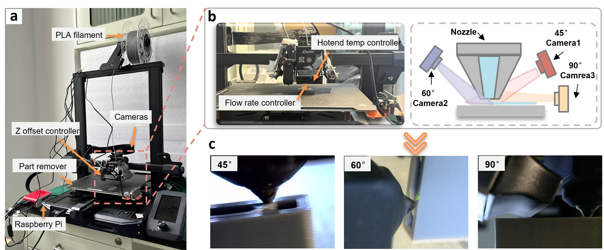
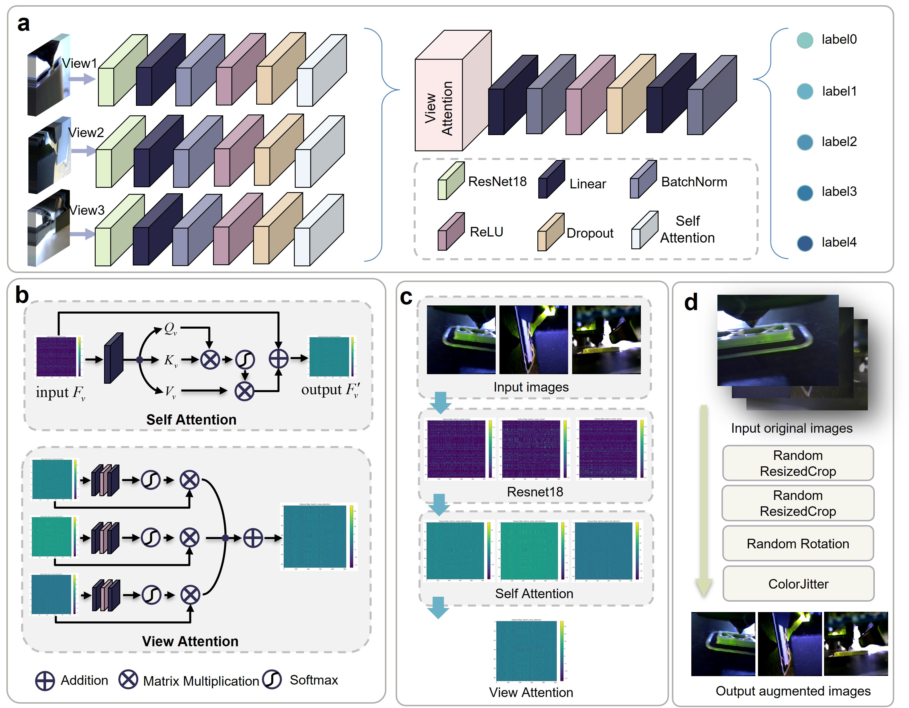
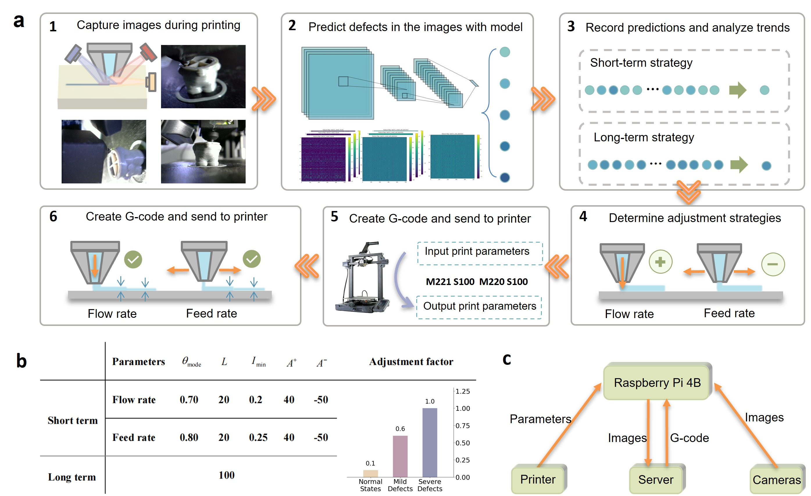
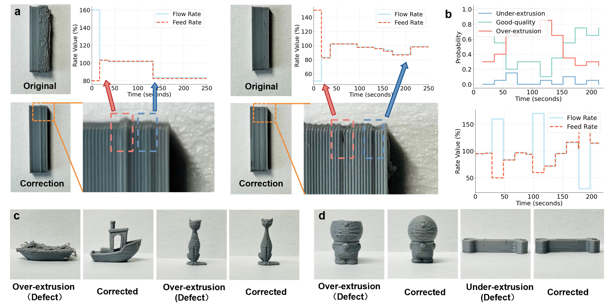

<div align="center">

# Multi-View Deep Information Fusion Framework (MVDIF-Net) for Online Quality Monitoring and Autonomous Correction in Material Extrusion Additive Manufacturing

[](https://doi.org/10.1080/17452759.2025.2500672)
[](https://doi.org/10.1080/17452759.2025.2500672)
[](https://www.python.org/)
[](https://pytorch.org/)
[](LICENSE)

**Bowen Yu**<sup>1,2</sup>, **Huaqing Zhang**<sup>1,2</sup>, **Jiafeng Tang**<sup>1,2</sup>, **Zhibin Zhao**<sup>1,2</sup>, **Xingwu Zhang**<sup>1,2</sup>, **Weifeng He**<sup>1,3</sup>, **Xuefeng Chen**<sup>1,2</sup>

<sup>1</sup> *National Key Lab of Aerospace Power System and Plasma Technology, Xi'an Jiaotong University, Xi'an, China*  
<sup>2</sup> *School of Mechanical Engineering, Xi'an Jiaotong University, Xi'an, China*  
<sup>3</sup> *Air Force Engineering University, Xi'an, China*

</div>

---

## Overview

Material extrusion / Fused Filament Fabrication (FFF/FDM) 3D printing frequently suffers from severe extrusion defects—such as over-extrusion and under-extrusion—that are often occluded or invisible from a single camera viewpoint on complex geometries.

This repository provides the core implementation of our **Multi-View Deep Information Fusion (MVDIF-Net)** framework and **dual-strategy closed-loop autonomous correction system**, published in *Virtual and Physical Prototyping* (2025):

- **Synchronized 3-Camera Multi-View Acquisition**: Three strategically positioned cameras (45°, 60°, and 90°) eliminate geometric occlusions around the nozzle and feed an automated OctoPrint data collection and labeling pipeline.
- **MVDIF-Net Architecture**: Combines shared-weight multi-view ResNet-18 feature extractors, intra-view **Self-Attention**, and cross-view **View-Level Attention** fusion to adaptively weight informative perspectives, achieving **97.67% detection accuracy** and **>97% F1-score** across all defect categories.
- **Dual-Strategy Autonomous Closed-Loop Control**: Integrates a **short-term sliding-window** analyzer for rapid defect response with **long-term trend validation** to issue stable G-code (`M221` flow rate & `M220` feed rate) corrections in real time via OctoPrint/Raspberry Pi.

<p align="center">
  
  <br>
  <em>Figure 1: Multi-view FFF monitoring platform (Ender-3 S1 with synchronized 45°, 60°, and 90° cameras and Raspberry Pi controller).</em>
</p>

---

## Network Architecture & Autonomous Correction Workflow

<p align="center">
  
  <br>
  <em>Figure 2: Overview of the MVDIF-Net multi-view fusion architecture (shared ResNet-18 branches, self-attention, view-level attention, and data augmentation pipeline).</em>
</p>

<p align="center">
  
  <br>
  <em>Figure 3: Dual-strategy online defect detection and closed-loop G-code parameter correction workflow.</em>
</p>

---

## Real-World Autonomous Correction Demonstrations

> *Note: This repository provides the core model, training/ablation, and online control source code along with selected paper figures. Full image datasets and trained weights are omitted due to size constraints.*

<p align="center">
  
  <br>
  <em>Figure 4: Real-world online correction experiments under severe over-extrusion and under-extrusion across diverse 3D geometries.</em>
</p>

---

## Repository Structure

```text
MVDIF-Net/
├── assets/                                         # Selected figures from the published paper
├── src/
│   ├── ybw_config.py                               # Hyperparameters, paths, and label definitions
│   ├── ybw_dataset.py / ybw_dataloader.py          # Multi-view & single-view dataset loaders
│   ├── backbone.py                                 # Backbone definitions
│   ├── yxx_multi_model_attention.py                # Core MVDIF-Net (Self-Attention + View Attention)
│   ├── yxx_multi_model_attention_1view.py          # Single-view attention variant
│   ├── yxx_multi_model_attention_with_visualization.py  # Feature-map visualization wrapper
│   ├── yxx_multi_model_contrast.py                 # Ablation model variants
│   ├── yxx_multi_train_attention.py                # Main 3-view MVDIF-Net training script
│   ├── yxx_multi_train_attention_1view.py          # 1-view ablation training
│   ├── yxx_multi_train_attention_2view.py          # 2-view ablation training
│   ├── yxx_multi_train_without_selfattention.py    # Ablation without self-attention
│   ├── yxx_multi_train_without_viewattention.py    # Ablation without view attention
│   ├── yxx_multi_train_without_shareweight.py      # Ablation without shared weights
│   ├── yxx_multi_test.py / yxx_multi_test_for_1view.py  # Evaluation scripts
│   ├── ybw_single_model.py                         # Single-view baseline architectures
│   ├── ybw_single_train_*.py / ybw_single_test.py  # Single-view baseline training & evaluation
│   ├── code_to_take_3_picture.py                   # Automated 3-camera OctoPrint data acquisition
│   ├── code_random_take_3_picture.py               # Randomized parameter sampling acquisition
│   ├── ybw_real_time_control.py                    # Full dual-strategy online closed-loop controller
│   └── ybw_real_time_control_without_longterm.py   # Short-term-only control ablation
└── requirements.txt
```

---

## Quick Start

### 1. Installation

```bash
git clone https://github.com/ybw110/MVDIF-Net.git
cd MVDIF-Net
python -m venv .venv
source .venv/bin/activate        # On Windows: .\.venv\Scripts\Activate.ps1
pip install -r requirements.txt
```

### 2. Training & Evaluation (MVDIF-Net)

Configure dataset paths and hyperparameters in `src/ybw_config.py`, then run:

```bash
cd src
python yxx_multi_train_attention.py
python yxx_multi_test.py
```

### 3. Online Real-Time Autonomous Correction (Hardware Deployment)

Set your OctoPrint API key via environment variable and configure the printer/camera stream URLs before launching closed-loop control:

```bash
export OCTOPRINT_API_KEY="your_octoprint_api_key"
cd src
python ybw_real_time_control.py
```

---

## Citation

If you find this work helpful in your research, please cite our published paper:

```bibtex
@article{yu2025mvdif,
  title     = {Multi-view deep information fusion framework for online quality monitoring and autonomous correction in material extrusion additive manufacturing},
  author    = {Yu, Bowen and Zhang, Huaqing and Tang, Jiafeng and Zhao, Zhibin and Zhang, Xingwu and He, Weifeng and Chen, Xuefeng},
  journal   = {Virtual and Physical Prototyping},
  volume    = {20},
  number    = {1},
  pages     = {e2500672},
  year      = {2025},
  publisher = {Taylor \& Francis},
  doi       = {10.1080/17452759.2025.2500672}
}
```

## License

This project is released under the [MIT License](LICENSE).
